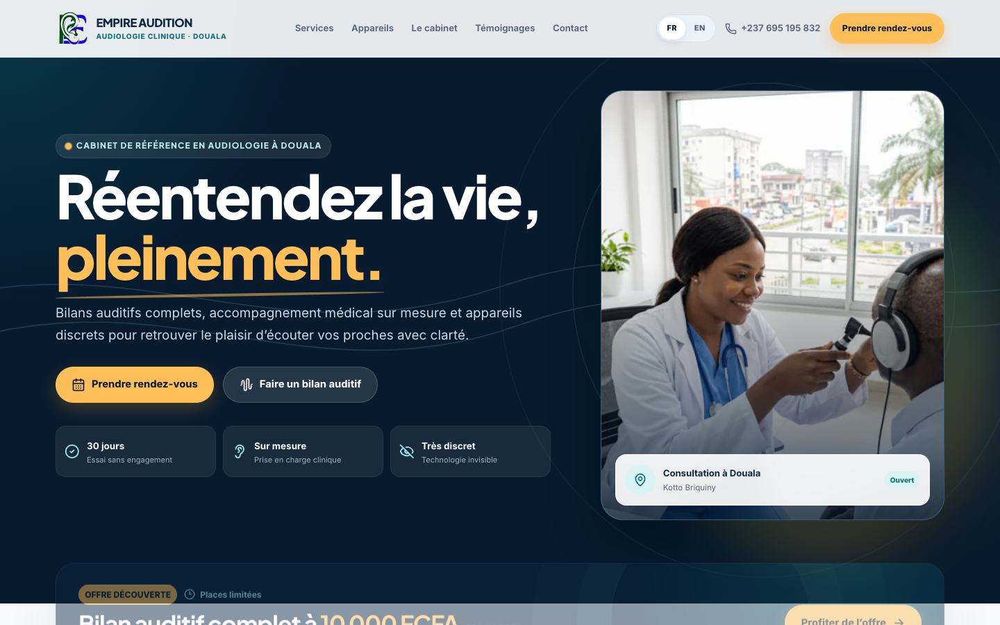

# Empire Audition — Douala



Capture de l'accueil servi en local (`nuxt dev`), le domaine public ne répondant pas depuis cette machine.


Site vitrine du cabinet d’audiologie **Empire Audition** (Kotto Briquiny, Douala). Bilans auditifs, appareillage et prise de rendez-vous — en français et en anglais.

**Production :** [https://empireaudition.cm](https://empireaudition.cm)

## Stack

- [Nuxt 4](https://nuxt.com/) (Vue 3) — génération statique
- [@nuxtjs/i18n](https://i18n.nuxtjs.org/) — `fr` (défaut) et `en`
- TypeScript strict
- Déploiement prévu sur Vercel (`nuxt generate`)

## Prérequis

- Node.js **≥ 20.19**
- npm

## Démarrage

```bash
npm ci
npm run dev
```

Ouvre [http://localhost:3000](http://localhost:3000) (`/` en français, `/en` en anglais).

## Scripts

| Commande | Description |
| --- | --- |
| `npm run dev` | Serveur de développement |
| `npm run generate` | Build statique (`.output/public`) |
| `npm run build` | Build Nuxt |
| `npm run preview` | Prévisualiser le build |
| `npm run typecheck` | Vérification TypeScript |

## Structure

```
app/
  components/     # Header, Hero, sections cliniques, booking, Footer
  composables/    # Animations (reveal)
  data/           # Métadonnées UI (icônes, etc.)
  pages/          # Page d’accueil
  assets/css/     # Styles globaux
i18n/locales/     # Textes FR / EN
public/images/    # Images et logos
```

Les contenus marketing sont dans `i18n/locales/fr.json` et `en.json`. Les icônes / tons des listes sont dans `app/data/content.ts`.

## Déploiement

Le projet est configuré en **statique** (`nitro.preset: 'static'`). Sur Vercel :

- build : `nuxt generate`
- sortie : `.output/public`

Voir `vercel.json`.

## Licence

Projet privé — Empire Audition.
